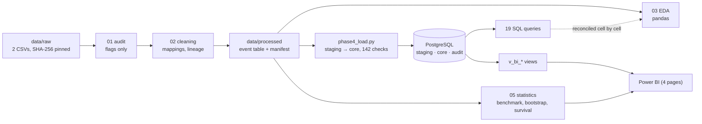

# Global Layoffs Intelligence & Workforce Analytics

An end-to-end analytics project on 5,000 news-reported layoff events (January 2019 to June 2026): a hash-verified Python cleaning pipeline, an audited PostgreSQL load with integrity checks, analytical SQL, a statistics notebook that tests how far a 26% sample can be trusted, and a Power BI dashboard built on SQL views.

**Who it is for:** workforce-strategy and talent teams asking how often layoffs happen, where they concentrate, how big they are, and which companies cut repeatedly. Every number states how much it depends on undisclosed headcounts, unknown sectors and partial 2026 data.

## Key findings

| # | Finding | How well supported |
|---|---|---|
| 1 | Layoff **events** peaked in 2020 (968 in the sample, partly furloughs), fell to 265 in 2021, and have stayed high since 2023 (885, 791, 762). | Strong: event counts match the full data within about ±1 pp |
| 2 | Most disclosed layoffs are small (median 200 people), and a few very large events dominate job totals. | Moderate: half of events disclose no headcount |
| 3 | **About 1 in 8 companies (12.6%, 95% CI 11.5–13.8%) lays off again within 12 months** of its first layoff in the data, and about 16% within 24 months. | Moderate: Kaplan-Meier with censoring |
| 4 | Only "2020 had the most disclosed job cuts" survives a company-cluster bootstrap. **2023, 2024 and 2025 cannot be ranked by jobs cut** from this sample. | Strong: bootstrap + external benchmark |

## Read before quoting any number

- **26% sample.** The global file keeps every event of a fixed, hash-chosen subset of companies (5,000 of 19,208 events). Counts are sample counts, never market totals.
- **Disclosed jobs are lower bounds.** Only verified headcounts are summed; the 2,511 undisclosed events stay NULL, never 0.
- **2026 is incomplete.** Data ends on 14 June 2026, and May–June look thin (collection lag).
- **The 35-row tech file is kept separate.** Its source and licence are unknown, its company size is derived from its own percentage, and it never enters a global figure.

## Architecture



| Layer | Files | What it guarantees |
|---|---|---|
| Raw | `data/raw/` | Never modified; SHA-256 checked in every notebook |
| Audit (Phase 1) | `notebooks/01_*`, `src/phase1_validation.py` | 18 quality flags; nothing fixed silently |
| Cleaning (Phase 2) | `notebooks/02_*`, `src/phase2_*.py`, `data/processed/` | One event table (5,035 × 69); every row traces to a raw file and line; 16 logged rules |
| EDA (Phase 3) | `notebooks/03_*`, `src/phase3_eda.py`, `reports/eda/` | Chart data saved and tested |
| Database (Phase 4) | `sql/ddl/`, `src/phase4_*.py`, `sql/analytics/` | One-transaction load, rerun-safe, 142 checks, audit trail |
| Statistics (Phase 5) | `notebooks/05_*`, `src/phase5_stats.py`, `reports/stats/` | Sample benchmark, cluster bootstrap, Kaplan-Meier |
| BI (Phase 5) | `sql/ddl/06_bi_views.sql`, `src/phase5_export_bi.py`, `powerbi/` | Global-only views; headline numbers reconciled with pandas |

## Methods

- **Sample validity.** Sample aggregates are divided by the full-population tables of the data card. A perfect 26% sample gives 0.260; events stay within 0.256–0.271 by year, while disclosed jobs swing from 0.225 to 0.341.
- **Uncertainty.** A company-cluster bootstrap (1,000 replicates, 90% percentile intervals) resamples whole companies, because that is how the sample was drawn.
- **Repeat layoffs.** One row per company: time from its first event to its second, right-censored at 14 June 2026. Kaplan-Meier with Greenwood (log-log) 95% intervals; log-rank tests between groups. Written in NumPy/SciPy and unit-tested against hand-worked examples.
- **Deliberately not built:** a severity classifier (ROC-AUC ≈ 0.63 in a feasibility probe, and a target that exists only for the non-random half of disclosed events), a monthly forecast, and an "AI layoffs" page (41 relevant rows).

Full detail: [METHODS.md](METHODS.md). Column definitions: [DATA_DICTIONARY.md](DATA_DICTIONARY.md).

## Setup (Windows)

1. Install Python 3.11+ and PostgreSQL 13+ (tested on Python 3.14.6 and PostgreSQL 18).
2. Install the packages:
   ```bash
   python -m pip install -r requirements.txt
   ```
3. Copy `.env.example` to `.env` and type your PostgreSQL user and password into it in Notepad. `.env` is git-ignored.
4. Create an empty UTF-8 database once (in pgAdmin or *SQL Shell (psql)*):
   ```sql
   CREATE DATABASE layoffs_db ENCODING 'UTF8' TEMPLATE template0;
   ```
5. Run the pipeline from the project folder:
   ```bash
   python -m pytest -q tests
   python src/phase4_load.py
   python src/phase4_analytics.py
   python src/phase5_export_bi.py
   ```
6. Optional database tests (they create and drop their own `layoffs_test_*` databases; nothing else is touched):
   ```powershell
   $env:LAYOFFS_ENABLE_DB_TESTS = "1"; python -m pytest -q tests
   ```
7. Dashboard: `python src/phase5_build_pbip.py` (writes your local folder into the model's `ProjectFolder` parameter), then open `powerbi/LayoffsDashboard.pbip` in Power BI Desktop and click *Refresh*. Power BI asks for the PostgreSQL user and password itself; nothing is stored in the project. Steps and DAX: [powerbi/DASHBOARD_BUILD_GUIDE.md](powerbi/DASHBOARD_BUILD_GUIDE.md).

**Public repository.** The GitHub version is built from a `public-release` branch that leaves out every file containing rows from the technology layoffs file (unknown licence); see [PUBLIC_RELEASE.md](PUBLIC_RELEASE.md). With it you can read and test the code, SQL, statistics and dashboard design, but rebuilding `data/processed/` and loading PostgreSQL needs that file.

**Reproducibility.** The loader is safe to rerun: each run replaces the core tables with the same rows in one transaction and is recorded in `audit.load_runs`. A fresh clone can run Phases 3 to 5 from `data/processed/` (verified against its SHA-256 manifest). Rerunning Phases 1 and 2 also needs the tech raw file, which is not published.

## Dashboard

Four pages, built on PostgreSQL views (Power BI Project: `powerbi/LayoffsDashboard.pbip`). Every page carries the sample-coverage banner.

| Executive overview | Industry and geography | Companies and repeat layoffs |
|---|---|---|
|  |  |  |

Page 4 (data quality and coverage) is in the project; its screenshot is not published because it shows the separate tech case-study rows.

## Verification status (Windows, 24–25 Oct 2026)

| Check | Result |
|---|---|
| Three consecutive loads | 5,035 events and 142/142 checks each time, identical content (md5 fingerprint) |
| 19 SQL queries | 19/19 ran; 16 reconciled with pandas, 979 cells, 0 mismatches |
| Tests (with database) | 214 passed, 0 failed |
| Dashboard | 14/14 headline numbers match SQL; slicers tested against SQL ([validation](reports/POWERBI_VALIDATION.md)) |

More: [STATUS.md](STATUS.md) · [METHODS.md](METHODS.md) · [DATA_DICTIONARY.md](DATA_DICTIONARY.md) · [Findings](reports/FINDINGS.md) · [Interview prep](reports/INTERVIEW_PREP.md) · [Resume bullets](reports/RESUME_BULLETS.md) · [Query catalogue](reports/phase4/QUERY_CATALOG.md)

## Limitations

1. **Sample, not the market.** 26% company sample of one news-based source. Unreported layoffs are missing, and coverage favours large, English-covered companies.
2. **Disclosed jobs are lower bounds** and cover about half of events; disclosure is higher in North America (55%) than elsewhere. Year rankings by jobs are not supported beyond "2020 was highest".
3. **2026 is partial** (to 14 June), and May–June look incomplete.
4. **31% of events have no sector and 9% no country**; both stay visible as Unknown.
5. **Company names are not merged without evidence**, so large brands can be split, which undercounts their repeat layoffs.
6. **Survival estimates are associations**, left-truncated at January 2019, and affected by the source merging reports within 45 days. Nothing here establishes a cause.
7. **No layoff rate** can be computed: the global file has no company size.

## Data and licence

- **Global file.** Fliar Research (2026). *Layoffs Dataset 2019–2026: Global, India, US, UK* (sample release). Data: Radar API, https://github.com/fliarbi/radar-api-mcp. **Licence CC BY-NC 4.0**: free to share and adapt for non-commercial use with attribution. This repository and anything derived from it inherit that restriction. Full-population benchmark figures are taken from the publisher's data card (`data/raw/SOURCE_DATA_CARD.md`).
- **Tech file** (`tech_layoffs_2025_2026.csv`, 35 rows): **source and licence unknown.** Its company size is derived from its own percentage, and 6 dates look wrong. The raw file is git-ignored and not published. Its 35 derived rows in `data/processed/` are labelled low confidence, are kept out of every global figure, and appear only in a separate case-study panel.

## Repository layout

```
data/raw  data/interim  data/processed   notebooks/01-05   src/   sql/ddl  sql/analytics
tests/    reports/ (eda, stats, phase4, figures, audit)   powerbi/
```
Older phase reports are kept in `reports/history/`; `STATUS.md` is the current status.
