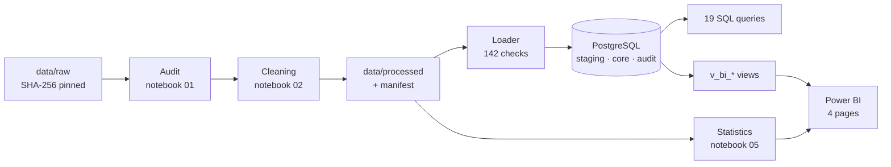
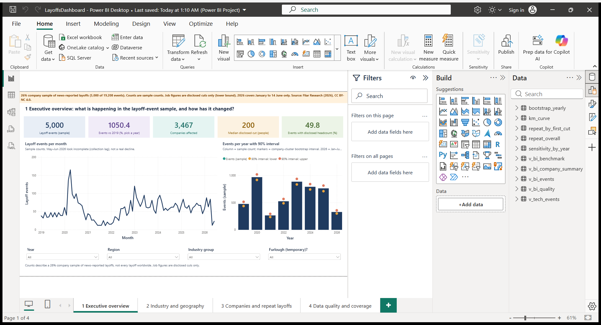
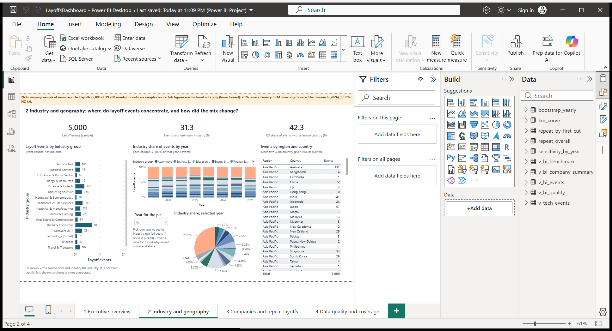
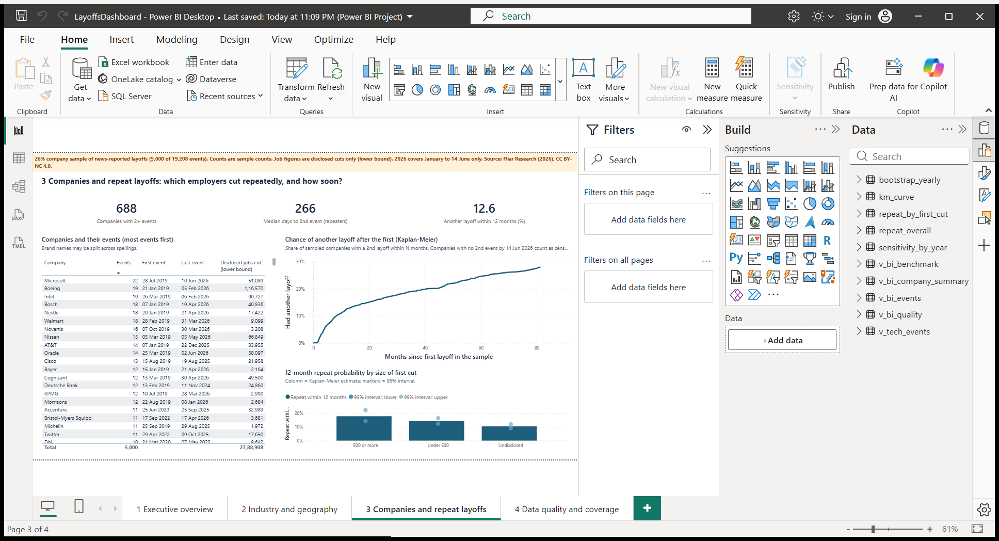

# Global Layoffs Intelligence & Workforce Analytics

**Business problem.** Workforce-strategy and talent teams need to know how often layoffs happen, where they concentrate, how large they are, and which employers cut repeatedly, without over-reading news-based data. This project answers those questions from a 26% sample of news-reported layoff events (January 2019 – 14 June 2026) and states, for every number, how far it can be trusted.

**What it shows:** a hash-verified Python audit and cleaning pipeline, an audited PostgreSQL load with 142 integrity checks, 19 analytical SQL queries reconciled with pandas, a statistics notebook (sample benchmark, company-cluster bootstrap, Kaplan–Meier), and a 4-page Power BI dashboard built on SQL views. 214 automated tests.

## Executive summary

| Question | Answer from the data | Support |
|---|---|---|
| Is layoff activity unusual now? | Events stayed far above 2019 (476) in 2023–2025 (885, 791, 762). 2020 peaked at 968, partly furloughs. | Strong: event counts track the full data within about ±1 pp |
| Can we rank recent years by jobs cut? | No. 2023–2025 disclosed-job intervals overlap; only "2020 was highest" holds. | Strong: bootstrap + publisher's full-data tables |
| How big is a typical layoff? | Median disclosed cut 200 people; 69.5% of disclosed cuts are under 500. | Moderate: half of events disclose no headcount |
| Where do layoffs concentrate? | Retail & Consumer is the largest known industry (13.6%); the US share of known-country events rose from 27.6% (2021) to 48.5% (2023). | Moderate: 31% Unknown industry, 9% no country |
| Do companies cut again? | 12.6% (95% CI 11.5–13.8%) had another layoff within 12 months of their first; 16.2% within 24 months. | Moderate: Kaplan–Meier with censoring; association only |

Details, evidence and decisions: [docs/business_findings.md](docs/business_findings.md).

## Read before quoting any number

- **Sample, not a census.** The global file keeps every event of a fixed, hash-chosen subset of companies (5,000 of 19,208 events). Counts are sample counts.
- **Disclosed jobs are lower bounds.** Only verified headcounts are summed; the 2,511 undisclosed events stay NULL, never 0.
- **2026 is incomplete** (to 14 June; May–June look thin).
- **Unknown industry is not zero layoffs**; it is shown, not hidden.
- **The 35-row tech file is a separate case study** with unknown source and licence and never enters a global figure.

## Tools

Python (pandas, NumPy, SciPy, matplotlib, Jupyter) · PostgreSQL 18 (psycopg2) · SQL (CTEs, window functions, filtered aggregates) · Power BI Desktop (Power BI Project / TMDL, DAX) · pytest · Git.

## Architecture



Stage by stage, schemas, tables and tests: [docs/architecture.md](docs/architecture.md).

## Data

| Dataset | Rows | Source and licence | Use |
|---|---|---|---|
| `data/raw/layoffs_2019_2026_sample.csv` | 5,000 | Fliar Research (2026), *Layoffs Dataset 2019–2026: Global, India, US, UK* (sample release), Radar API. **CC BY-NC 4.0** (non-commercial, attribution required) | All global analysis |
| `data/raw/SOURCE_DATA_CARD.md` | — | Same publisher | Full-population benchmark tables |
| `tech_layoffs_2025_2026.csv` | 35 | **Unknown** source and licence; not published | Separate, low-confidence case study only |

Columns and units: [docs/data_dictionary.md](docs/data_dictionary.md).

## Data quality and cleaning

Raw files are never modified and are SHA-256 pinned. Problems are **flagged**, not fixed silently (18 quality flags). One event table (5,035 × 69) is built through 16 logged rules; every row traces back to its raw file and line. Missing headcounts, industries and countries stay missing; possible duplicates are flagged, not merged. See [docs/methodology.md](docs/methodology.md).

## PostgreSQL and SQL

Schemas `staging` (10 text tables, COPY), `core` (11 typed tables with keys, plus views) and `audit` (load runs, file hashes, check results). The loader replaces `core` in **one transaction** and commits only if all **142 checks** pass; three consecutive loads produced identical content. 19 read-only queries ([catalogue](reports/phase4/QUERY_CATALOG.md)); 16 reconcile with pandas over **979 cells, 0 mismatches**.

## Statistics

- **Sample validity:** sample ÷ full-population ratios. Events 0.256–0.271 by year (expected 0.260); disclosed jobs 0.225–0.341.
- **Company-cluster bootstrap:** 1,000 replicates resampling whole companies; 90% intervals for yearly events and disclosed jobs.
- **Kaplan–Meier:** time from a company's first to second sampled layoff, right-censored at 14 Jun 2026; Greenwood log-log 95% intervals; log-rank tests.
- **Deliberately not built:** a severity classifier (probe ROC-AUC ≈ 0.63, selection-biased target), a forecast, an AI-layoffs page. The project makes no predictive or causal claim.

## Dashboard

Four pages on PostgreSQL views (`powerbi/LayoffsDashboard.pbip`); the sample-coverage banner is on every page.

| 1 Executive overview | 2 Industry and geography | 3 Companies and repeat layoffs |
|---|---|---|
|  |  |  |

Page 4 (data quality and coverage, including the separate tech case-study panel) is in the project; its screenshot is not published because it shows tech-file rows. Navigation: page tabs at the bottom; page 1 slicers filter page 1; the "Year for the pie" selector on page 2 filters only the pie; "Group by" on page 4 filters only the disclosure-rate chart. Validation: [reports/POWERBI_VALIDATION.md](reports/POWERBI_VALIDATION.md).

## Reproduce on Windows

```powershell
python -m pip install -r requirements-lock.txt
Copy-Item .env.example .env        # then type your PostgreSQL password into .env
python -m pytest -q tests          # no database needed
python src/phase4_load.py
python src/phase4_analytics.py
$env:LAYOFFS_ENABLE_DB_TESTS = "1"; python -m pytest -q tests
```

Full steps, which commands were tested, and Power BI refresh: [docs/setup_windows.md](docs/setup_windows.md). The public repository omits the tech file and the processed data built from it ([PUBLIC_RELEASE.md](PUBLIC_RELEASE.md)), so a public clone runs 135 tests and skips the 79 that need PostgreSQL or the excluded data.

## Validation evidence (Windows, 24–25 Oct 2026)

| Check | Result |
|---|---|
| Raw data | SHA-256 unchanged |
| Loads | 3 consecutive runs: 5,035 events, 142/142 checks each, identical content |
| SQL | 19/19 queries; 979 cells reconciled, 0 mismatches |
| Tests | 214 passed with PostgreSQL; 191 passed + 23 skipped without |
| Dashboard | 14/14 headline numbers match SQL; selectors tested against SQL |

Current status: [STATUS.md](STATUS.md).

## Limitations

News-based (unreported layoffs missing; favours large, English-covered companies); 26% sample; disclosed jobs are lower bounds and disclosure is uneven (North America 55.3% vs Latin America 41.3%); 2026 partial; 31% Unknown industry, 9% no country; brand names can be split; survival results are associations, left-truncated at 2019; no company size, so no layoff rates.

## Possible next steps

Review the 13 company names marked `needs_review` and the 26 proposed merges; add a company-domain grouping to reduce split brands; rerun the pipeline when the publisher releases a new sample.

## More

[Methodology](docs/methodology.md) · [Data dictionary](docs/data_dictionary.md) · [Business findings](docs/business_findings.md) · [Architecture](docs/architecture.md) · [Setup](docs/setup_windows.md) · [Resume and interview notes](docs/resume_and_interview.md) · [Query catalogue](reports/phase4/QUERY_CATALOG.md)

Repository layout: `data/` · `notebooks/01–05` · `src/` · `sql/ddl`, `sql/analytics` · `tests/` · `powerbi/` · `reports/` (`history/` holds older phase reports) · `docs/` · `deliverables/`.
