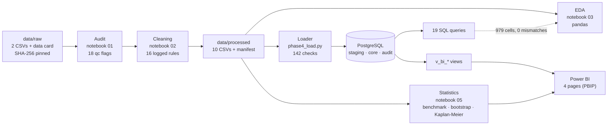

# Architecture

## Stages

| Stage | Code | Output | Guarantee |
|---|---|---|---|
| Raw | `data/raw/` | `layoffs_2019_2026_sample.csv` (5,000 rows), `tech_layoffs_2025_2026.csv` (35 rows, local only), `SOURCE_DATA_CARD.md` | Never modified; SHA-256 checked by notebooks and tests |
| Audit | `notebooks/01_*`, `src/phase1_validation.py` | `data/interim/` staged copies, `reports/audit/` | Problems are flagged (18 `qc_*` columns), never fixed silently |
| Cleaning | `notebooks/02_*`, `src/phase2_cleaning.py`, `src/phase2_mappings.py` | `data/processed/` (event table 5,035 × 69, mappings, lineage, logs, SHA-256 manifest) | Every row traces to its raw file and line; missing values stay NULL; nothing merged |
| EDA | `notebooks/03_*`, `src/phase3_eda.py` | `reports/eda/`, `reports/figures/03_*` | Chart data saved and tested |
| Database | `sql/ddl/01–06`, `src/phase4_load.py`, `src/phase4_checks.py`, `src/phase4_config.py` | PostgreSQL `layoffs_db` | One transaction; 142 checks; failed check = rollback; every run in `audit` |
| SQL analytics | `sql/analytics/01–19`, `src/phase4_analytics.py` | `reports/phase4/query_results/`, `sql_reconciliation.csv` | Read-only; reconciled with pandas |
| Statistics | `notebooks/05_*`, `src/phase5_stats.py` | `reports/stats/`, `reports/figures/05_*` | Unit-tested maths; seeded bootstrap |
| BI | `sql/ddl/06_bi_views.sql`, `src/phase5_export_bi.py`, `src/phase5_build_pbip.py` | `powerbi/LayoffsDashboard.pbip`, `powerbi/headline_reconciliation.csv` | Report generated from code, validated against Microsoft's schemas; 14 headline numbers reconciled |
| Release | `src/make_public_release.py` | git branch `public-release` | Excludes tech-derived data, caches and local paths |

## PostgreSQL

- **`staging`**: text copies of the 10 processed CSVs, loaded with COPY; types and keys are checked here first.
- **`core`**: 11 typed tables (`layoff_events`, mappings, quality issues, lineage, duplicate pairs, departments) with primary and foreign keys; views `v_global_events`, `v_tech_events`, `v_period_notes`, `v_duplicate_group_members`, `v_industry_disagreement_global_events`, and the five `v_bi_*` reporting views.
- **`audit`**: `load_runs`, `load_files`, `validation_results`.

The global/tech split is enforced in one place: every global query and view reads `core.v_global_events`.

## Power BI

Import mode. Sources: the five `v_bi_*` views and `v_tech_events` from PostgreSQL, plus notebook 05's CSV outputs (bootstrap, Kaplan-Meier, repeat probabilities) and query 19's result. Pages: 1 Executive overview, 2 Industry and geography, 3 Companies and repeat layoffs, 4 Data quality and coverage. The tech table is not related to any global table, so it cannot leak into global numbers. Validation: [`reports/POWERBI_VALIDATION.md`](../reports/POWERBI_VALIDATION.md).

## Tests (`tests/`, pytest)

| File | What it checks |
|---|---|
| `test_phase1_*`, `test_phase2_*` | Audit and cleaning rules, output fingerprints, lineage |
| `test_phase3_eda.py` | Aggregations reconcile with the event table; missing never becomes 0 |
| `test_phase4_unit.py` | Loader pre-flight rejects bad files |
| `test_phase4_db.py` (18, needs PostgreSQL) | Clean load, repeat load, NULL preservation, rollback, query reconciliation |
| `test_phase5_stats.py` | Kaplan-Meier, log-rank and bootstrap maths; saved notebook outputs |
| `test_phase5_bi_views.py` (5, needs PostgreSQL) | Each BI view against pandas; no tech rows |
| `test_phase5_pbip.py` | Report files vs Microsoft schemas, bindings, layout, slicer wiring, interval charts |

Database tests run only with `LAYOFFS_ENABLE_DB_TESTS=1`; they create and drop their own `layoffs_test_*` databases.
