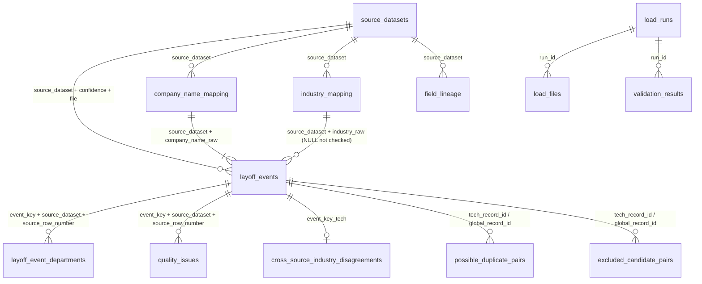

# Phase 4: PostgreSQL schema and relationships

DDL (version-controlled): `sql/ddl/01_schemas.sql` … `05_views.sql`. The column specification used by the loader and tests lives in `src/phase4_spec.py`, and the tests check that the DDL and the spec agree.

## 1. Layers

| Schema | Purpose | Reloaded? |
|---|---|---|
| `staging` | An exact **text** copy of each processed CSV, with the same columns and no constraints. It shows what arrived, before any typing. | Emptied and refilled inside every load transaction |
| `core` | Typed, constrained analytical tables. Queries, notebooks and (later) Power BI read only these. | Contents replaced inside **one** transaction, and committed only if every check passes |
| `audit` | One row per load run, per file and per validation check. | **Never** emptied (append and update only) |

## 2. Relationship diagram

**The same relationships in words:**
- One source has many events.
- One raw company name (per source) has one or more events. Every event has a mapping row.
- One raw industry label has zero or more events. A missing label is NULL in the events table and `(missing)` in the mapping table.
- One tech event has 0-2 department rows.
- One event has 0 to many quality-issue rows (one per TRUE flag).
- One tech event has at most one industry-disagreement row.
- A pair row links exactly one tech event to one global event.

The child tables use a **composite** foreign key (`event_key`, `source_dataset`, `source_row_number`). A child row can't point to the right key but the wrong source line.

## 3. Tables, keys and nullability

| Table | Rows | Primary key | Other unique keys | Foreign keys | Required (NOT NULL) |
|---|---|---|---|---|---|
| `core.source_datasets` | 2 | `source_dataset` | `source_file`; (`source_dataset`, `source_confidence`, `source_file`) | none | all |
| `core.company_name_mapping` | 3,532 | (`source_dataset`, `company_name_raw`) | none | source | all |
| `core.industry_mapping` | 77 | (`source_dataset`, `industry_raw`) | none | source | all |
| `core.layoff_events` | 5,035 | `event_key` | (`source_dataset`, `source_row_number`); `source_event_id`; (`event_key`, `source_dataset`, `source_row_number`) | source, company mapping, industry mapping | 33 columns (identifiers, dates, groups, statuses, `qc_issue_count` and the 11 flags computed for both sources). The other 36 are nullable. |
| `core.layoff_event_departments` | 70 | (`event_key`, `department_position`) | (`event_key`, `department`) | event (composite) | all |
| `core.quality_issues` | 4,886 | (`event_key`, `quality_flag`) | none | event (composite) | all |
| `core.transformation_log` | 16 | `rule_id` | none | none | all except `examples` |
| `core.field_lineage` | 54 | (`canonical_field`, `source_dataset`, `source_field`) | none | source | all |
| `core.cross_source_industry_disagreements` | 9 | `event_key_tech` | none | event | all |
| `core.possible_duplicate_pairs` | 18 | `pair_id` | (`tech_record_id`, `global_record_id`) | both record ids → events | all except headcount/% of the global side, news URL and reviewer notes |
| `core.excluded_candidate_pairs` | 97 | `excluded_pair_id` | (`tech_record_id`, `global_record_id`) | both record ids → events | as above |
| `audit.load_runs` | 1 per run | `run_id` (identity) | none | none | status, version, input folder, manifest flag |
| `audit.load_files` | 10 per run | (`run_id`, `file_name`) | none | run | file, hash, CSV rows |
| `audit.validation_results` | about 142 per run | (`run_id`, `check_id`) | none | run | all except expected/actual |

**Other constraints on `layoff_events`:**
- `event_key` must look like `G-00001` or `T-00001`.
- `event_year`, `event_month` and `event_quarter` must agree with `event_date`.
- The quarter must be between 1 and 4, and the month between 1 and 12.
- `ai_related` must be one of `Yes`, `Partial` or `No`.
- `possible_duplicate_group` must look like `DG-001`.

## 4. Data types (chosen from the actual values)

| CSV content | PostgreSQL type | Columns |
|---|---|---|
| Identifiers and labels | `TEXT` | keys, names, groups, statuses, URLs, excerpts |
| `YYYY-MM-DD` | `DATE` | `event_date`, and `tech_date` / `global_date` in the pair tables. `event_date_raw` stays TEXT next to it. |
| Whole numbers written as `50.0` | `INTEGER` / `SMALLINT` | headcounts, totals, `news_mentions`, `rows`, row numbers (`SMALLINT` for year, month, quarter, severance weeks, positions and `qc_issue_count`). The loader rejects any value with a fraction. |
| Decimals with up to 6 places | `NUMERIC` (no fixed scale) | `workforce_pct`, `allocation_weight`, `headcount_diff_pct`, `tech_pct`, `global_pct`. They are stored exactly as written, with no rounding. |
| `True` / `False` / empty | `BOOLEAN` | 18 `qc_*` flags, `is_furlough`, `is_permanent_layoff`, `possible_internal_duplicate`, `ai_mentioned_in_news_derived`. An empty field means **not computed**, and it is stored as NULL, never as FALSE. |
| `Yes` / `Partial` / `No` | `TEXT` + CHECK | `ai_related`. It has three values, so it is **not** BOOLEAN. |

## 5. Indexes and what they speed up

| Index | Helps |
|---|---|
| `ix_events_source_date` (`source_dataset`, `event_date`) | monthly and yearly trends per source |
| `ix_events_industry` (`source_dataset`, `industry_group`) | industry rankings |
| `ix_events_region` (`source_dataset`, `region`, `country`) | region and country comparisons |
| `ix_events_company` (`source_dataset`, `company_name`) | repeat layoffs by company |
| `ix_events_dup_group` (partial, `possible_duplicate_group IS NOT NULL`) | duplicate-group review |
| `ix_events_industry_fk` | industry-mapping foreign key lookups |
| `ix_departments_dept`, `ix_quality_flag`, `ix_pairs_global`, `ix_excluded_global` | department counts, flag summaries, pair lookups from the global side |

Primary keys and unique constraints add their own indexes. The table is small (5,035 rows), so these indexes are mostly for clarity and for Power BI DirectQuery later.

## 6. How lineage and data quality are preserved

- **Traceability.** Every event keeps:
  - `event_key`, which is the Phase 1 record id;
  - `source_dataset`, `source_file` and `source_row_number`, the exact CSV line in the raw file;
  - `source_event_id`, the global `layoff_id`;
  - every `*_raw` column next to its cleaned version.
- **Mappings and logs.** `company_name_mapping`, `industry_mapping`, `field_lineage` and `transformation_log` are loaded as they are, and foreign keys prove that every event's raw name and label is in its mapping.
- **Quality.** All 18 `qc_*` flags are kept, with TRUE, FALSE and NULL (not computed). `quality_issues` holds one row per TRUE flag, and a check verifies the two always agree.
- **Duplicates.** `possible_duplicate_group` and both pair tables are loaded with `review_status` unchanged.
  - **No primary record is chosen and nothing is merged.**
  - The view `core.v_duplicate_group_members` only lists the members of each group.
- **Suspect dates.** The 6 tech rows keep their original dates (`event_date` = `event_date_raw`), with `qc_suspect_date = TRUE`.
- **Sources stay apart.**
  - `core.source_datasets` records each source's confidence and known limitations.
  - The views `core.v_global_events` and `core.v_tech_events` keep the two sources apart in queries.
  - No query adds tech rows to global totals.
- **Load audit.** Each run records its timestamp, versions, input folder (relative), the SHA-256 of each file compared with the Phase 2 manifest, the CSV, staging and core row counts, and every check result. Failed runs are recorded too.

## 7. Deliberate differences from the CSV schema

1. `transformation_log.column` is renamed **`column_name`** (`column` is a reserved word in SQL). This is the only rename.
2. **`core.source_datasets` is new.** It is a 2-row reference table written by the loader from `src/phase4_spec.py`, with descriptions taken from the source data card and the Phase 1-3 reports. It doesn't come from a CSV.
3. Whole numbers written as `50.0` become INTEGER, and `True` / `False` / empty become BOOLEAN / NULL. The values themselves are unchanged, and the reconciliation checks prove it.
4. **`phase2_output_manifest.csv` is not a table.** It is used to verify the files before each load, and its hashes are stored in `audit.load_files`.
5. **Not built, on purpose:** the company, sector, country and date dimensions mentioned in the old `NOTEBOOK_PLAN.md`. Your Phase 4 brief rules out normalisation that could lose the original names or traceability.
6. **Value-range rules are not CHECK constraints** (headcount > 0, % between 0 and 100). Phases 1-2 keep out-of-range values and flag them, so they are checked by validation queries instead.
7. **`cross_source_industry_disagreements.global_event_keys` stays a `;`-separated text**, as in the CSV. The view `core.v_industry_disagreement_global_events` splits it into one row per key, and a check proves every key exists.
